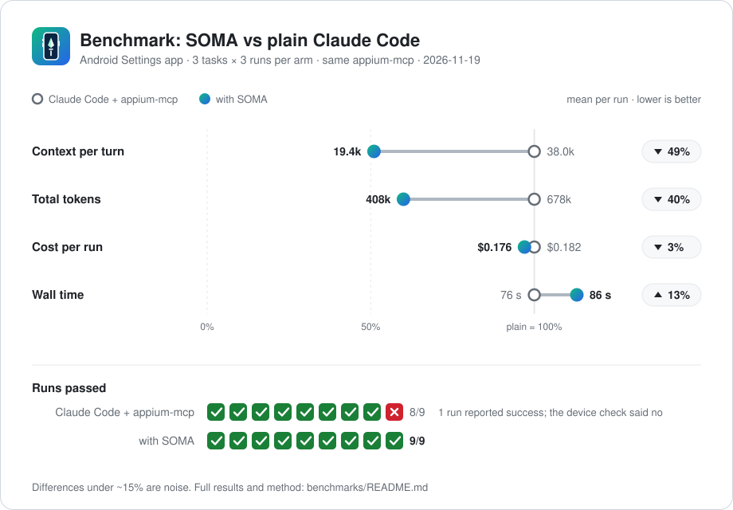

<div align="center">


*A Claude plugin for mobile QA testers: run manual test cases on real devices, triage failures, and write bug reports.*

[](https://github.com/Dor-bl/soma-plugin/actions/workflows/ci.yml)
[](.claude-plugin/plugin.json)
[](https://www.apache.org/licenses/LICENSE-2.0)
[](https://docs.claude.com/en/docs/claude-code/plugins)
[-412991)](#in-codex-experimental)
[](https://github.com/appium/appium-mcp)


[-662d91?logo=appium&logoColor=white)](backends/appium.md)
[-4285F4?logo=google&logoColor=white)](backends/artemis.md)

</div>

---

## ✨ Overview

SOMA wraps the official [`appium-mcp`](https://github.com/appium/appium-mcp) server and adds test-focused **skills** and **slash commands** on top of it, so you can drive Android and iOS devices with plain language.

**No code required.** Manual QA can use SOMA as is: describe a test case in plain language, watch it run on a device, and get a bug report when something fails. Generating automated tests (`/soma:gen-test`) is optional.

<p align="center">
  <a href="benchmarks/README.md#rerun-after-device-runner-2026-11-19">
    <picture>
      <source media="(prefers-color-scheme: dark)" srcset="assets/benchmark-dark.svg">
      
    </picture>
  </a>
</p>

## 📦 What's inside

| Type | Name | Description |
|------|------|-------------|
| 🧠 Skill | `check-setup` | Verify your local environment (Node, SDKs, devices) is ready |
| 🧠 Skill | `setup-artemis` | Install the optional Google Artemis engine for this project only, step by step |
| 🧠 Skill | `start-device` | Start an Android emulator or iOS simulator, wait for a full boot, and diagnose crashes |
| 🧠 Skill | `run-manual-test` | Execute a manual test case step by step on a device |
| 🧠 Skill | `triage-failure` | Investigate a failed step and pinpoint the likely cause |
| 🧠 Skill | `bug-report` | Draft a structured bug report from a failure or observation, as Markdown, Jira wiki markup or plain text |
| 🧠 Skill | `generate-test` | Turn a manual test case into an automated Appium test script |
| 🧠 Skill | `explore-app` | Exploratory testing of an app area; reports suspected issues with evidence |
| 🧠 Skill | `write-test-case` | Draft a manual test case from a feature, user story or bug report, ready for `run-manual-test` |
| 🤖 Agent | `device-runner` | Runs a confirmed test case on the device for `run-manual-test` (Appium), so screenshots and page source stay out of your conversation |
| ⚡ Command | `/soma:setup [focus]` | Check your environment is ready and explain how to fix what is missing |
| ⚡ Command | `/soma:artemis [folder]` | Install the optional Artemis engine for this project, asking before each step |
| ⚡ Command | `/soma:device [avd or simulator name]` | Start an emulator or simulator and wait until it is ready |
| ⚡ Command | `/soma:run-test [platform] [steps or path]` | Run a manual test case through Appium |
| ⚡ Command | `/soma:bug [what you saw]` | Draft a bug report |
| ⚡ Command | `/soma:gen-test [framework] [steps or path]` | Generate an automated test from a manual test case |
| ⚡ Command | `/soma:explore [platform] [area]` | Explore an app area and report suspected issues |
| ⚡ Command | `/soma:triage [failure log or path]` | Triage a failed test run and suggest next steps |
| ⚡ Command | `/soma:test-case [feature, story, bug or path]` | Draft a manual test case to run with `/soma:run-test` |

**Under the hood**

- 🔌 `.mcp.json` launches `appium-mcp` through `scripts/start-appium-mcp.mjs`, which installs the version and dependency tree locked in `runtime/package-lock.json` with `npm ci --ignore-scripts` into the plugin's data folder on first start (about 370 MB; local embedded drivers by default)
- 📱 `scripts/start-emulator.mjs`: used by `start-device` to start an emulator detached and watch it boot
- ⚙️ `remote_server_url` setting: leave empty for local, or point it at a remote Appium/WebDriver server or device cloud. Only that exact URL is allowed, and only if it's `https://` (plain `http://` for localhost only) with no embedded credentials. When it's empty, all remote servers are blocked
- 🔑 `capabilities_file` setting (optional): a `capabilities.json` read from disk by `appium-mcp`. Put device-cloud credentials here instead of in the URL or the chat. Only `check-setup` reads it, after you approve the command, to check that it exists and is valid JSON without printing it; the other skills are told never to open it. Claude's file tools could still read it, so keep it out of the project folder and out of version control
- 🗺️ `app_map_dir` setting (optional): a folder where `explore-app` saves the locators it found per app and `run-manual-test` and `generate-test` reuse them to skip repeat lookups; `triage-failure` reads them only as evidence of a changed locator (Appium only). Empty means off. Maps hold element names and locators, never typed or on-screen user data. `/soma:setup app map` checks the folder exists and warns if it sits in a git repository without being ignored. Format and rules: [`backends/app-map.md`](backends/app-map.md)
- 🧩 Engines: skills describe *what* to do; [`backends/`](backends/README.md) describes *how* each engine does it

## 🧩 Engines

| Engine | Platforms | Setup | Used for |
|--------|-----------|-------|----------|
| [Appium](backends/appium.md) *(default)* | Android, iOS | Bundled | Everything |
| [Google Artemis](backends/artemis.md) *(optional)* | Android | Install separately and register for this project only ([avoid the global installer](backends/artemis.md#install)); needs its own LLM API key | `explore-app` by default when installed; `run-manual-test` and `triage-failure` when you ask for it |

Without Artemis installed, SOMA behaves exactly as before. Artemis is an autonomous agent: SOMA runs it one test step at a time and checks its trace, so it can't route around a bug and report a pass.

> [!NOTE]
> SOMA's version pin and remote-URL allowlist cover `appium-mcp` only. Artemis is installed and updated outside SOMA, and its own agent and LLM key are yours to manage.

## 🛠️ Requirements (local mode)

| Platform | Needs |
|----------|-------|
| All | [Node.js](https://nodejs.org/) 22.19 or newer within Node 22, or 24 or newer (`^22.19.0 \|\| >=24.0.0`, required by `appium-mcp` and its dependencies; Node 23 is not supported). SOMA checks this before it installs `appium-mcp` |
| 🤖 Android | Android SDK, `adb`, an emulator or physical device |
| 🍎 iOS | macOS with Xcode and a simulator *(iOS isn't available locally on Windows/Linux)* |

## 🚀 Install

In Claude Code 2.1.275 or newer:

```text
/plugin install soma --marketplace Dor-bl/soma-plugin
```

Or in two steps: `/plugin marketplace add Dor-bl/soma-plugin`, then `/plugin install soma@soma-plugin`. To pick up a new version later, run `/plugin marketplace update soma-plugin`.

> [!IMPORTANT]
> The first start installs `appium-mcp` and its locked dependencies (about 370 MB) from `registry.npmjs.org`, which can take minutes. Claude Code waits 30 seconds for an MCP server, so `appium-mcp` may show as *failed to connect* at first. The install keeps running in the background: reconnect with `/mcp` once it has finished, or run `/soma:setup` first and let it install the server before your first test.

`/soma:setup` (the `check-setup` skill) checks Node, the SDKs and your devices and explains how to fix what is missing. Add a focus such as `android`, `ios`, `artemis` or `app map` to check one area.

### In Codex (experimental)

SOMA also ships a Codex manifest (`.codex-plugin/plugin.json`) and marketplace (`.agents/plugins/marketplace.json`). Add the marketplace, then install SOMA from `/plugins` in Codex or from the ChatGPT desktop app:

```bash
codex plugin marketplace add Dor-bl/soma-plugin
```

Tested with Codex CLI 0.171.0 on Windows (Android 13 emulator) and on macOS (Android emulator and iOS 27 simulator): the marketplace install, `check-setup` and short `run-manual-test` cases passed. It differs from the Claude Code plugin:

- **First start.** Start an interactive `codex` session and leave it open until `appium-mcp` has installed (several minutes). A short session, such as `codex exec`, can end the install before it finishes. After that, the `appium-mcp` tools appear about 15 seconds after a session starts, through Codex's tool search.
- **Skills and `appium-mcp`.** Ask for a skill by name, for example "use the check-setup skill" or "use the run-manual-test skill to run this test case on Android". The `/soma:*` commands and the `device-runner` agent are written for Claude Code; in the tested run, `run-manual-test` ran the steps in the conversation.
- **Tool approvals.** Codex asks before each `appium-mcp` tool call; approve them in an interactive session. `codex exec` cannot ask, so by default it rejects every call (`MCP tool call requires approval, but approval policy is never`) and the skills report their steps as BLOCKED. Run `codex exec --approve-for-me`, which sends approval requests to Codex's automatic review, or use an interactive session. With Codex CLI 0.171.0, a `default_tools_approval_mode` setting did not apply to the plugin's server.
- **Sandbox (macOS).** Codex's `workspace-write` sandbox blocks `xcrun simctl` (`CoreSimulatorService connection became invalid`) and makes `~/.appium` read-only, so `appium driver list` fails. `appium-mcp` runs outside the sandbox, so device steps are not affected, and `check-setup` checks simulators through `appium-mcp` instead.
- **Appium only.** `setup-artemis` registers Artemis with Claude Code's `claude mcp` commands, so in Codex it stops before changing anything, and the skills use Appium.
- **No saved screenshots or page source.** Codex has no Read tool, so the skills never open the PNG and XML files `appium-mcp` saves. They check elements with `appium_find_element`, report a check that needs a screenshot as not checked visually, and give you the saved path to open. Plugin and project files are read as usual.
- **Local mode only.** Codex has no plugin settings, so `remote_server_url`, `capabilities_file` and `app_map_dir` are unset: local devices only, every remote server blocked, app maps off.
- **Environment.** Codex gives MCP servers only a short list of environment variables. SOMA's Codex config also passes `ANDROID_HOME`, `ANDROID_SDK_ROOT`, `JAVA_HOME`, `DEVELOPER_DIR`, `APPIUM_MCP_WDA_APP_PATH` (the iOS WebDriverAgent fallback) and SOMA's folder overrides (`SOMA_DATA_DIR`, `SCREENSHOTS_DIR`, `PAGE_SOURCES_DIR`), and waits up to 10 minutes for the first start, which installs `appium-mcp`. It does not pass the proxy variables, since a proxy URL can carry a user name and password; behind a proxy, set it in your `.npmrc` for the install.
- **Install location.** Codex gives the server no data folder, so unless you set `SOMA_DATA_DIR` to an absolute path, `appium-mcp` installs into the plugin's own folder (`.runtime/`), and each new SOMA version installs it again. While any Codex session is running SOMA's server from that folder, Codex cannot update the plugin: `codex plugin marketplace upgrade` and the automatic refresh fail with "Access is denied", and the installed copy keeps working. Close your Codex sessions, then upgrade.

To try a checkout without installing it, start Claude from the folder *above* the clone (inside it, `.mcp.json` loads as a project server and cannot start):

```bash
claude plugin validate ./soma-plugin
claude --plugin-dir ./soma-plugin
```

## 🏁 Quick start

Once SOMA is installed, try:

```text
/soma:run-test android "Open the app, log in with test user, verify the home screen"
/soma:bug "Checkout button does nothing after adding a coupon"
/soma:triage "Login test failed: NoSuchElementException on #submit after the 4.2 build"
/soma:explore android "checkout with a coupon code"
/soma:test-case "Users can apply one coupon code per order at checkout"
```

## 🔐 What SOMA runs, sends and fetches

- **Fetches** `appium-mcp` and its locked dependencies on first start and after a pin change, into the plugin's data folder: from `registry.npmjs.org`, plus two dependencies the lockfile pins to GitHub commits, so GitHub must be reachable too. Beyond that, downloads happen only in the cases you choose: preparing an iOS simulator downloads WebDriverAgent from GitHub through `appium-mcp` (unless you point it at a WebDriverAgent you already run), and the optional Artemis setup clones Artemis from GitHub and installs its Python dependencies.
- **Runs locally** `node` for the launcher and `appium-mcp`; `adb` and the Android emulator for Android; `xcrun simctl` on macOS for iOS; and the test clients you run yourself for generated scripts. Appium's drivers install their device-side agents (UiAutomator2 server, WebDriverAgent) on the emulator or simulator when a session starts, as any Appium setup does. Skills ask before installing an app or changing anything on your machine.
- **Sends** device commands to local devices, or to the one remote server you configure. SOMA itself opens no other connections and sends no telemetry. What the tools return (on-screen text, page source, screenshots) enters your Claude Code conversation like any tool result, so it reaches the model provider your Claude Code is configured with before the skills' redaction, which applies to reports and chat output. With the optional Artemis engine there is a second recipient: Artemis sends screenshots and screen text, including notifications, to the LLM provider behind its own API key, which need not be the same provider; the skills ask for your consent before each Artemis run. Device-cloud credentials stay in your capabilities file and reach only that server.
- **Reads** on-screen text, page source and screenshots from the device during a test. The skills treat them as untrusted data, never follow instructions found in them, and redact secrets before quoting them in reports.
- **Stores** files only on your machine, and never uploads or deletes them itself (a screenshot it reads enters the conversation, as under **Sends**). Remove them when you no longer need them. With Appium, screenshots and saved page source go to `screenshots/` and `page-sources/` under the plugin's data folder, created owner-only (mode 0700) on macOS and Linux. If you set `SCREENSHOTS_DIR` or `PAGE_SOURCES_DIR`, they go to your folder as it is, with its permissions unchanged; if the private folder cannot be set up, `appium-mcp` falls back to the OS temp folder, which other users of a shared machine may be able to read. With Artemis, its live screenshot (overwritten on each capture) and its per-step trace images stay in the Artemis clone or the trace or app directory you set for Artemis, and the copies SOMA keeps as evidence go to your work folder or the clone. App maps, if turned on, hold element names and locators in the folder you choose, never typed or on-screen user data. Screenshots and page source can show whatever was on the device screen, personal data included.

## ⚠️ Known limitations (v0.2)

> [!WARNING]
> SOMA is in beta. Expect rough edges, and please report them.

- 🧪 Lightly tested on devices: every skill has completed at least one run on an Android 13 emulator through Appium (headless, 2026-11-07), and `explore-app` has run once through Artemis. On iOS, `start-device`, `run-manual-test`, `triage-failure` and `bug-report` have run on an iOS 18.6 simulator on an Apple silicon Mac (headless, 2026-11-12); `generate-test` and `explore-app` haven't run on iOS yet. A clean install from the marketplace has been checked on Windows and macOS, followed by `/soma:setup` and one `/soma:run-test`. Physical devices and app maps haven't been run yet.
- 🌐 Remote mode is untested: no run has gone through a remote Appium server or device cloud yet. The allowlist that blocks every other host is covered by CI.
- 🛡️ Protection against prompt injection from app or device content (e.g. on-screen text telling Claude to run a command) relies on skill instructions, not tool restrictions. Tool-level limits are tracked in issue #8.
- 📌 `appium-mcp` is pinned to an exact version (`1.97.1`), and its whole dependency tree is locked with integrity hashes in `runtime/package-lock.json`. Bump them together, deliberately, after testing. 0.2.0 holds 1.97.1 on purpose: newer releases fail the first WebDriverAgent install on iOS 18.2 simulators ([appium/appium-mcp#608](https://github.com/appium/appium-mcp/issues/608)), and iOS on Intel Macs is untested with them. Install scripts are skipped, so packages that need one (e.g. browser driver downloads) are not set up.
- 🌐 The remote URL policy covers the URL you configure only. Redirects and direct-connect endpoints chosen by the server aren't re-checked, so only point SOMA at servers you trust.
- 🔓 SOMA can't add authentication to a self-hosted Appium server. Put it behind an authenticating reverse proxy or VPN; never expose it unauthenticated on a shared network.

## 🧑‍💻 Developing SOMA

To load your checkout as a plugin, use `--plugin-dir` from the folder above the clone (see [Install](#-install)).

To work *inside* the repo, note that Claude Code loads `.mcp.json` as a project server, not as a plugin. `${CLAUDE_PLUGIN_ROOT}` and `${user_config.*}` are not substituted, so `appium-mcp` shows *failed to connect* (`Connection closed`). Plugin users are not affected. To get the device tools, run this from the root folder of the clone, not a subfolder (`$PWD` must be the clone root, and local scope applies only to the folder you run it in). It adds a server with the absolute path to the launcher and overrides the project entry for you only:

```bash
claude mcp add --scope local appium-mcp -- node "$PWD/scripts/start-appium-mcp.mjs"
```

`$PWD` works in bash, zsh and PowerShell. In Windows `cmd`, use `%CD%` instead.

This entry passes no remote URL, so only local devices work, unless `SOMA_REMOTE_SERVER_URL` is exported in your shell (then that one URL is allowed). Do not edit `.mcp.json` to fix the error: its variables are what make the plugin work for users.

The checks CI runs, and the conventions they enforce, are in [`AGENTS.md`](AGENTS.md).

## 📄 License

Released under the [Apache License 2.0](https://www.apache.org/licenses/LICENSE-2.0).
